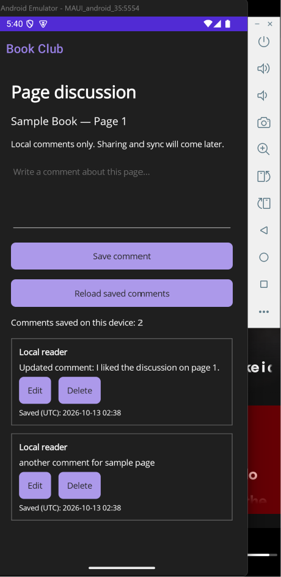
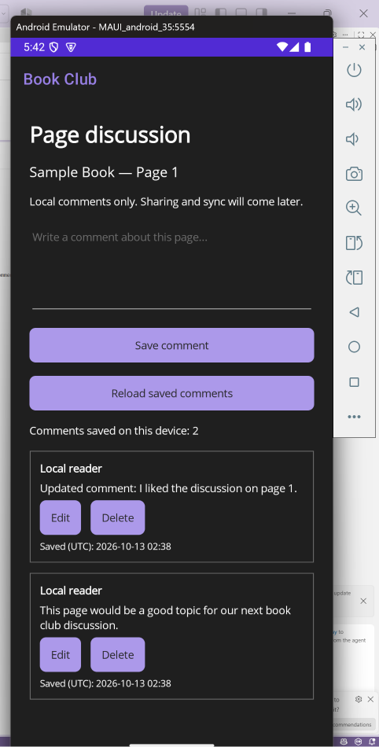
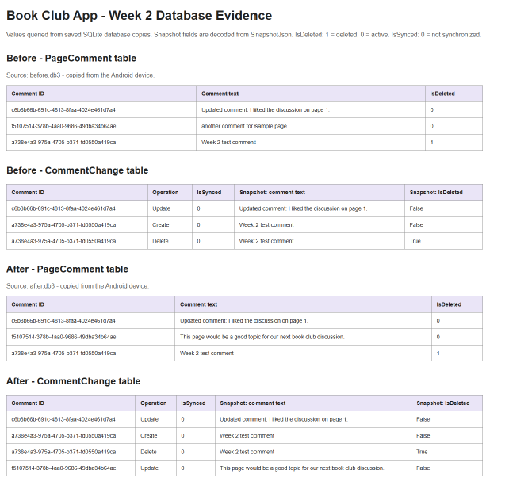
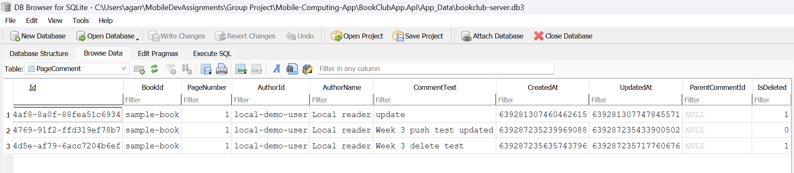
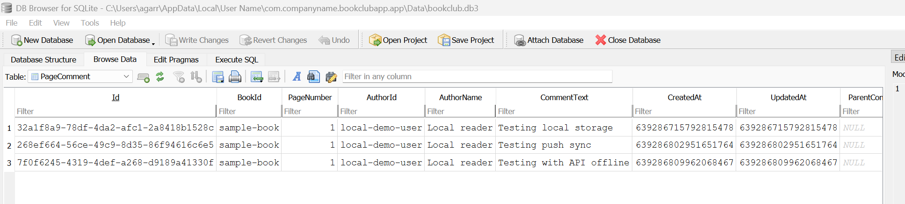
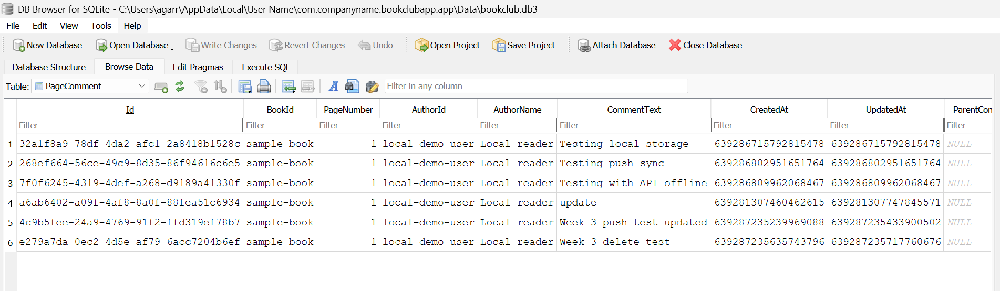

# Book Club App

## Description

Book Club App is a mobile application for readers to discuss digital
books together. The planned features include uploading a book, commenting
on individual pages, and replying to other readers' comments without
changing the book's text.

The app will support reading downloaded books and writing comments
offline, with changes synchronized when an internet connection is
available.

## Domain Entity: PageComment

PageComment represents a comment attached to a specific book and page.

Properties:

- Id: Unique identifier for the comment.
- BookId: Identifier of the book being discussed.
- PageNumber: Page the comment refers to.
- AuthorId: Identifier of the comment's author.
- AuthorName: Display name of the author.
- CommentText: Content of the comment.
- CreatedAt: UTC date and time the comment was created.
- UpdatedAt: UTC date and time the comment was last updated.
- ParentCommentId: Optional reference to another comment for replies.
- IsDeleted: Marks a comment as deleted while retaining its record for future synchronization.

## Week 1 – Planning & Setup

- [x] Choose domain entity: PageComment.
- [x] Set up MAUI project.
- [x] Set up SQLite.
- [x] Set up server or mock API.
- [x] Complete README with app name, description, and Week 1 progress.
- [x] Submit screenshot of rendered README and zipped .git file to Canvas.

## Current App Status

The app displays a sample page discussion screen where users can create, read, update, and delete comments stored in SQLite. Changes remain after closing and reopening the app. Deleted comments are hidden from the discussion but retained in the database with IsDeleted set to true.

Each create, update, or delete operation also saves a CommentChange record in the same database transaction. Book uploads, shared discussions, and online/offline synchronization are not yet implemented.

An ASP.NET Core API server was created and added to the solution. Microsoft Dev Tunnels was configured to allow access from other devices. The server and tunnel were tested in a browser.

## Planned Synchronization Behavior

Synchronization must preserve separate comments added to the same page
online or offline. Conflicting edits to the same comment must be detected
and handled without silently discarding either version. Offline comments
must remain stored locally until the server confirms they were saved.

## Development Environment

- .NET SDK: 11.0.100-preview.7.26381.103
- Android target: net11.0-android
- Editor: Visual Studio Code
- Test device: MAUI android 35 emulator
- API framework: ASP.NET Core
- Using Microsoft Dev Tunnels
- Local storage: SQLite

## Week 2 – Local CRUD & Change Tracking

- [x] Implement and test creating, reading, updating, and deleting comments.
- [x] Confirm changes remain after closing and reopening the app.
- [x] Implement local change tracking.
- [x] Verify Create, Update, and Delete records in SQLite.
- [x] Capture the device UI before and after a change.
- [x] Capture database tables before and after the same change.
- [x] Include change-tracking evidence.
- [x] Document Week 2 progress while retaining Week 1 progress.
- [x] Submit the rendered README screenshot and required ZIP to Canvas.

### Change Tracking

The CommentChange table records each change with a unique ID, the affected comment's ID, the operation, a UTC timestamp, a JSON snapshot of the comment, and an IsSynced flag.

The comment change and its tracking record are saved in the same SQLite transaction. Deleted comments remain in the PageComment table with IsDeleted set to true. Change records currently have IsSynced set to false because synchronization has not been implemented yet.

### Testing Completed

- Created a comment and confirmed it remained after reloading.
- Edited a comment and confirmed the updated text was saved.
- Deleted a test comment and confirmed it disappeared from the discussion.
- Reopened the app and confirmed the retained comments, edited text, and deletion persisted.
- Inspected SQLite copies from the Android emulator and verified Create, Update, and Delete records.

### Before and After Example

The second active comment was changed from “another comment for sample page” to “This page would be a good topic for our next book club discussion.”

The comment kept the same ID, and the number of visible comments remained at two. The CommentChange table increased from three records to four, with a new Update record linked to that comment.

#### Device UI Before

#### Device UI After

#### Database and Change-Tracking Evidence

The tables below were generated by querying before.db3 and after.db3, copied from the Android app's SQLite database. Snapshot fields were decoded from SnapshotJson.

The before and after tables show the changed comment text and its new Update record. The previously deleted test comment remains marked IsDeleted = 1, and its Create and Delete records remain in the change log.

### Remaining Project Work

Book uploads, shared discussions, online/offline synchronization, and conflict resolution remain planned for later development.

## Week 3 - Push Sync

- [x] Implement push endpoint
- [x] Send pending changes
- [x] Clear pending changes on success
- [x] Add Week 3 progress documentation to README.md
- [x] Submit the rendered README screenshot and required ZIP to Canvas.

### Implement Push Endpoint

The /pushChanges endpoint receives changes in comments and saves them to the server database. The app connects to the server through Microsoft Dev Tunnels.

Both server tables were empty before syncing.

### Send Pending Changes

While the discussion page is open, the app checks for pending changes every 10 seconds. Changes remain stored locally if the server is unavailable.

Comments were created, edited, and deleted while the server was stopped. Before syncing, there were 7 pending changes with IsSynced set to 0 (indicating it has not synced yet).

After the server was restarted and the API link was corrected, all changes were received and processed.

The server receives and processes changes in the same database transaction. Each received change has ReceivedAt and ProcessedAt values.

The server stored comment records and remained marked IsDeleted = 1.
The row with CommentText "update" is from earlier testing. It is marked as deleted and is not part of the example.

### Clear Pending Changes on Success

After the server confirms that changes were saved, the app sets their IsSynced flag to true. The change records remain in the local database but are no longer pending.

All local change records had IsSynced set to 1 after syncing.

## Week 4 - Pull Sync

- [x] Implement pull endpoint
- [x] Apply incoming changes
- [x] Handle deletes
- [x] Add Week 4 progress documentation to README.md
- [x] Submit the rendered README screenshot and required ZIP to Canvas.

### Implement Pull Endpoint

The /pullChanges endpoint retrieves comments from the server database. During the first pull, it returns all comments, including deleted records. Subsequent pulls use the last synchronization timestamp to retrieve newer changes.

The app provides a Download Changes button to retrieve server records and an Apply Downloaded Changes button to process them locally.

### Apply Incoming Changes

Before syncing, the server database contained 3 comments from previous testing. Two were marked as deleted, and one was active.

The local database contained 3 different comments that had been created on the device.

The Download Changes button retrieves the server records and temporarily stores them in the IncomingComment table. These records are not added to the PageComment table until the user applies them.

After downloading, the Apply Downloaded Changes button processes the incoming records and updates the local PageComment table.

The local database increased from 3 records to 6 records. All 3 original comments remained, and the 3 server comments were successfully added.

### Handle Deletes

Deleted comments are synchronized using the IsDeleted flag rather than permanently removing their records.

The server returned two deleted comments along with the active comment. These records were successfully transferred to the local database.

Deleted comments remain stored for synchronization purposes but are excluded from the visible discussion.

## Week 5 - Conflict Handling & Audit Trail

- [x] Conflict strategy working
- [x] Audit logging on device
- [x] Audit logging synced to server
- [x] Add sync button and automatic sync
- [x] Automatic sync attempt both (online and offline)
- [ ] Submit rendered README.md and zipped .git files

### Week 5 Progress

The app now detects conflicts when two devices edit the same comment. Users can review both versions and choose which one they want to keep.

Testing was completed with two Android emulators connected to the same local API:

- Device A: MAUI_Emulator_API_37, emulator-5554
- Device B: my_pixel_36, emulator-5556

The tests used the same comment on both devices. The API was stopped while edits were made, then restarted so the saved changes could synchronize.

### Conflict Handling

Each server comment has a Version value. An edit includes the version it was based on.

When the server receives an edit based on an older version, it records a conflict instead of immediately replacing the current comment. The app displays the device and server versions for review.

Users have two choices:

- Keep my version: Save the device's edit as a pending change using the reviewed server version. The server checks it again before accepting it.
- Keep server version: Replace the local comment with the reviewed server version and resolve the pending conflict.

### Test 1 - Keep My Version

Both devices started with version 1 of the comment. While the API was stopped, each device saved a different edit.

Device A synchronized first. Its edit became version 2 on the server.

When Device B synchronized, its edit was still based on version 1. The app displayed a conflict showing Device B's text and the server's Device A text.

On Device B, Keep my version was selected. The app sent the device's edit again using server version 2, and it was accepted as version 3.

After Device A synchronized, both devices displayed "Week 5 Conflict Test (Device B)" with no unresolved conflicts.

The server database confirmed that the comment contained Device B's text, had Version = 3, and remained active with IsDeleted = 0.

### Test 2 - Keep Server Version

Both devices then started with version 3 of the comment.

While the API was stopped, Device A saved two edits, including a correction to the device letter in the comment. Device B saved a different edit.

Device A synchronized first. Its two accepted edits changed the server comment from version 3 to version 5.

When Device B synchronized, the app detected that its edit used version 3 while the server had version 5.

On Device B, Keep server version was selected. Both devices then displayed "Week 5 Conflict Test (Device A)x2" with no unresolved conflicts.

The server comment remained at version 5. Keeping the server version didn't create another server comment update.

### Audit Logging

The CommentAuditEntry table records what happened during synchronization and conflict resolution.

Each entry includes:

- A unique audit ID
- The change ID and comment ID
- The operation, outcome, and reason
- The version the edit was based on
- The server version before and after processing
- JSON snapshots containing the incoming comment and the server comment when available
- The UTC time the entry was recorded

Audit entries remain stored as history. Later actions create new entries instead of replacing earlier audit records.

The server audit from the first conflict test shows:

1. The original comment was created as version 1
2. Device A's update was accepted as version 2
3. Device B's older update produced a conflict
4. Device B's edit was sent again and accepted as version 3

The device audit includes both resolution decisions:

- Keep the device version
- Keep the server version

These entries record which version the user chose to keep. A Keep my version decision is followed by a separate accepted update when its pending edit reaches the server.

### Synchronizing Resolution Audits to the Server

Testing showed that resolution decisions were being saved on the device but were not reaching the server.

A /pushAuditEntries endpoint and device upload tracking were added so these decisions could also be stored in the server audit history.

The app sends resolution audit entries that the server has not yet confirmed receiving. Uploading these entries keeps their original IDs, timestamps, snapshots, and version information.

The server screenshot below shows both resolution decisions received from Device B.

A separate SyncedAuditEntry table records which audit entries the server has confirmed receiving. This records which entries were uploaded without changing the original audit records.

A fresh copy of Device B's database confirmed that both resolution entries were marked as synchronized to the server.

### Automatic Sync While the Server Is Unavailable

While the discussion page is open, the app attempts to upload pending changes every 10 seconds.

With the API stopped, both devices saved different edits locally. The automatic sync attempts reported connection failures, but the edited comments remained visible on each device.

### Automatic Sync After Reconnecting

After the API was restarted, Device A automatically uploaded its pending edit.

The app displayed "Automatically synced changes: 1." Device B's app was kept closed during this step so Device A's edit reached the server first.

### Manual Sync

The Sync now button allows users to start synchronization themselves. It sends pending changes and downloads and applies server changes when there are no unresolved conflicts.

During the second conflict test, Device A manually synchronized its two pending edits. The app reported "Sent changes: 2. Applied comments: 1."

### Additional Fixes and Verification

The automatic sync process was updated so it would not keep disabling the comment editor while the user was typing.

A PeriodicTimer checks for pending changes every 10 seconds while the discussion page is open. The checks stop when the user leaves the page. Manual and automatic sync operations wait for each other to finish before starting.

The completed tests verified:

- Local edits remain available when the API is stopped
- Automatic synchronization uploads pending changes after reconnection
- Manual synchronization sends pending edits
- Conflicting edits are displayed for review
- Keep my version and Keep server version both resolve the tested conflicts
- Both devices can display the same final comment after synchronization
- Resolution decisions remain stored on the device and are uploaded to the server
- The device records when the server confirms receiving the resolution audit entries
