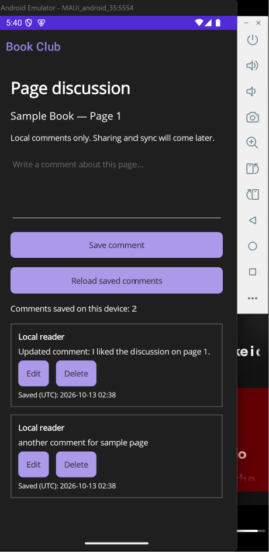
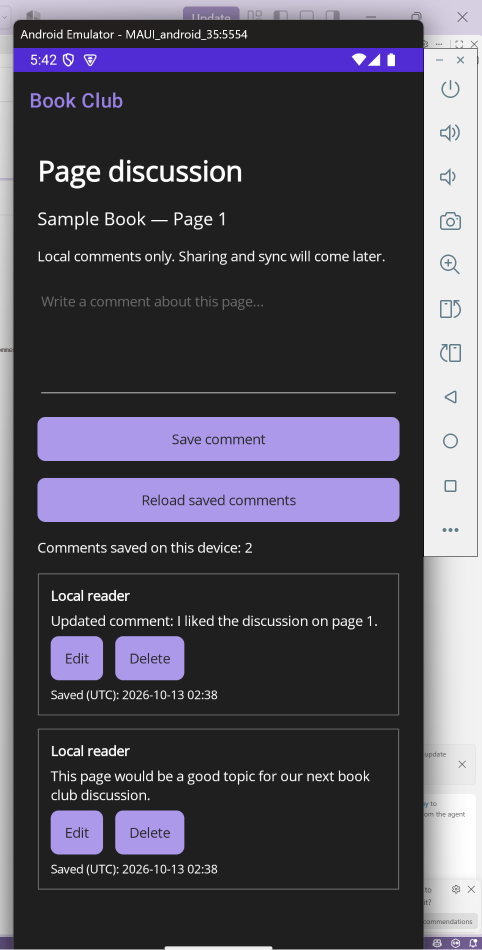
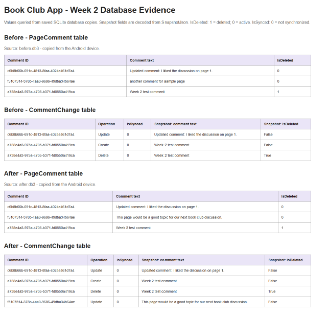

# Book Club App

## Description

Book Club App is a mobile application for readers to discuss digital
books together. The planned features include uploading a book, commenting
on individual pages, and replying to other readers' comments without
changing the book's text.

The app will support reading downloaded books and writing comments
offline, with changes synchronized when an internet connection is
available.

## Domain Entity: PageComment

PageComment represents a comment attached to a specific book and page.

Properties:

- Id: Unique identifier for the comment.
- BookId: Identifier of the book being discussed.
- PageNumber: Page the comment refers to.
- AuthorId: Identifier of the comment's author.
- AuthorName: Display name of the author.
- CommentText: Content of the comment.
- CreatedAt: UTC date and time the comment was created.
- UpdatedAt: UTC date and time the comment was last updated.
- ParentCommentId: Optional reference to another comment for replies.
- IsDeleted: Marks a comment as deleted while retaining its record for future synchronization.

## Week 1 – Planning & Setup

- [x] Choose domain entity: PageComment.
- [x] Set up MAUI project.
- [x] Set up SQLite.
- [x] Set up server or mock API.
- [x]  Complete README with app name, description, and Week 1 progress.
- [x] Submit screenshot of rendered README and zipped .git file to Canvas.

## Current App Status

The app displays a sample page discussion screen where users can create, read, update, and delete comments stored in SQLite. Changes remain after closing and reopening the app. Deleted comments are hidden from the discussion but retained in the database with IsDeleted set to true.

Each create, update, or delete operation also saves a CommentChange record in the same database transaction. Book uploads, shared discussions, and online/offline synchronization are not yet implemented.

An ASP.NET Core API server was created and added to the solution. Microsoft Dev Tunnels was configured to allow access from other devices. The server and tunnel were tested in a browser.

## Planned Synchronization Behavior

Synchronization must preserve separate comments added to the same page
online or offline. Conflicting edits to the same comment must be detected
and handled without silently discarding either version. Offline comments
must remain stored locally until the server confirms they were saved.

## Development Environment

- .NET SDK: 11.0.100-preview.7.26381.103
- Android target: net11.0-android
- Editor: Visual Studio Code
- Test device: MAUI android 35 emulator
- API framework: ASP.NET Core
- Using Microsoft Dev Tunnels
- Local storage: SQLite

## Week 2 – Local CRUD & Change Tracking

- [x] Implement and test creating, reading, updating, and deleting comments.
- [x] Confirm changes remain after closing and reopening the app.
- [x] Implement local change tracking.
- [x] Verify Create, Update, and Delete records in SQLite.
- [x] Capture the device UI before and after a change.
- [x] Capture database tables before and after the same change.
- [x] Include change-tracking evidence.
- [x] Document Week 2 progress while retaining Week 1 progress.
- [ ] Submit the rendered README screenshot and required ZIP to Canvas.

### Change Tracking

The CommentChange table records each change with a unique ID, the affected comment's ID, the operation, a UTC timestamp, a JSON snapshot of the comment, and an IsSynced flag.

The comment change and its tracking record are saved in the same SQLite transaction. Deleted comments remain in the PageComment table with IsDeleted set to true. Change records currently have IsSynced set to false because synchronization has not been implemented yet.

### Testing Completed

- Created a comment and confirmed it remained after reloading.
- Edited a comment and confirmed the updated text was saved.
- Deleted a test comment and confirmed it disappeared from the discussion.
- Reopened the app and confirmed the retained comments, edited text, and deletion persisted.
- Inspected SQLite copies from the Android emulator and verified Create, Update, and Delete records.

### Before and After Example

The second active comment was changed from “another comment for sample page” to “This page would be a good topic for our next book club discussion.”

The comment kept the same ID, and the number of visible comments remained at two. The CommentChange table increased from three records to four, with a new Update record linked to that comment.

#### Device UI Before

#### Device UI After

#### Database and Change-Tracking Evidence

The tables below were generated by querying before.db3 and after.db3, copied from the Android app's SQLite database. Snapshot fields were decoded from SnapshotJson.

The before and after tables show the changed comment text and its new Update record. The previously deleted test comment remains marked IsDeleted = 1, and its Create and Delete records remain in the change log.

### Remaining Project Work

Book uploads, shared discussions, online/offline synchronization, and conflict resolution remain planned for later development.